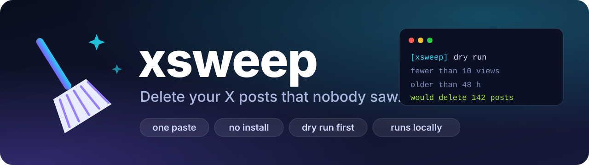

<p align="center">
  
</p>

<p align="center">
  <a href="https://github.com/GDLevSargsyan/xsweep/actions/workflows/test.yml"></a>
  <a href="LICENSE"></a>
  
  
  <a href="https://github.com/GDLevSargsyan/xsweep/stargazers"></a>
</p>

**xsweep** deletes the posts on your X (Twitter) profile that got **fewer than N views**: the ones nobody saw. It is a single file you paste into the browser console. No install, no login, no API key, no extension.

- 🧹 **Delete by views.** Everything under your threshold (10 views by default) goes, everything above it stays.
- 🛟 **Dry run first.** By default it only counts and shows what it *would* delete.
- 🔒 **Local only.** It clicks the same buttons you would click. It makes no network requests of its own and sends nothing anywhere.
- 🎯 **Careful.** It never touches pinned posts, reposts, other people's posts, or posts younger than 48 hours (they are still collecting views).
- 💬 **Posts only by default.** Your replies stay unless you ask for them.
- ⏱ **Polite pace.** About a post a second with random pauses and a breather every 100 deletions. It stops at the end of the timeline, and tries to stop when X shows a lock or verification notice.

## Quick start

1. **Back up first**, deleted posts cannot be restored: *Settings → Your account → Download an archive of your data*.
2. Open your own profile on [x.com](https://x.com) on the **Posts** tab (`x.com/<you>`).
3. Press `F12` and open the **Console**. (Chrome may ask you to type `allow pasting` first.)
4. Copy the whole of [`xsweep.js`](xsweep.js), paste it into the console and press `Enter`. You get a dry run:

   ```text
   [xsweep] DRY RUN - nothing will be deleted. @you / posts only / fewer than 10 views / older than 48 h.  Stop any time: XSWEEP.stop = true
   [xsweep] finished (end of the timeline). Would delete 142 / kept 61 with enough views / 3 too young / 1 pinned or reposted / 0 with unknown views.
   ```
5. Happy with the list? Delete for real. In the console run

   ```js
   window.XSWEEP_CONFIG = { DRY_RUN: false };
   ```

   then paste the script again. It asks once, then starts. To try it on a single post first, use `{ DRY_RUN: false, MAX_DELETIONS: 1 }`.

Keep the tab visible while it runs, browsers slow hidden tabs down. Stop at any time with `XSWEEP.stop = true`.

## Options

Set them before pasting the script, for example `window.XSWEEP_CONFIG = { DRY_RUN: false, BELOW_VIEWS: 50, MIN_AGE_HOURS: 24 };`

| Option | Default | What it does |
| --- | --- | --- |
| `BELOW_VIEWS` | `10` | Delete posts with **fewer** views than this. |
| `MIN_AGE_HOURS` | `48` | Leave posts younger than this alone. `0` includes brand-new posts. |
| `INCLUDE_REPLIES` | `false` | `false`: posts only, run it on the Posts tab. `true`: replies too, run it on the Replies tab (`x.com/<you>/with_replies`). |
| `DRY_RUN` | `true` | `true`: only count and list. `false`: really delete (asks once first). |
| `MAX_DELETIONS` | `0` | Stop after this many deletions. `0` means no limit. |
| `DOWNLOAD_LOG` | `true` | Save a JSON list of the deleted posts (id, views, date, text) when a real run ends. |
| `PAUSE_MS` | `[350, 800]` | Random pause after every deletion. |
| `BREAK_EVERY`, `BREAK_MS` | `100`, `[8000, 15000]` | A longer breather after this many deletions. |
| `STALL_PATIENCE` | `5` | How many ~50 s waits a stuck timeline gets before the run counts as finished (about 4 minutes). |
| `LABEL_DELETE`, `LABEL_VIEWS` | English | The words your X interface uses, see [other languages](#good-to-know). |

## How it works

1. It reads who you are from the account button in the sidebar and checks that you are on your own Posts (or Replies) tab.
2. It walks down the timeline the way you would scroll. For each of **your** posts it reads the view count from the post's analytics link.
3. It decides: pinned or reposted, skip. Unknown view count, skip. At or above the threshold, keep. Younger than `MIN_AGE_HOURS`, skip. Otherwise, delete.
4. It deletes through the post's `...` menu, **Delete**, confirm, exactly like a person, and waits until the post is gone.
5. When X stops loading older posts (it sometimes stalls), it scrolls back and forth and waits a few minutes before deciding that this is the end of your timeline.
6. It keeps a list of everything it deleted in `XSWEEP.log`, in `localStorage` and in a downloaded JSON file.

No private API, no cookies, no tokens: the script is about 200 lines of plain DOM code, you can read all of it before you paste it.

## Good to know

- **It is irreversible.** Archive first. Start with `MAX_DELETIONS: 1`.
- **Automation on X.** X's terms restrict automated actions. xsweep drives the normal web page at a human-like pace, but you use it **at your own risk** (rate limits and temporary locks happen). It is not affiliated with X Corp.
- **Other languages.** The English interface is built in. For another one, set `LABEL_DELETE` (the *Delete* item in a post's menu) and `LABEL_VIEWS` (the analytics label, for example `"1234 views. View post analytics"`) to what your interface says. Posts whose view count it cannot read are never deleted.
- **Views come in late.** X counts views with a delay, that is why posts younger than 48 hours are left alone.
- **Hands off.** The script scrolls the page itself, so do not use that tab while it runs and do not minimize the window.
- **Speed.** Roughly 3,000 posts an hour. Big accounts take a while, that is on purpose.
- **X changes its page now and then.** If something stops working, open an issue with the dry-run console output.

## FAQ

**Does it delete my replies?** Not unless you set `INCLUDE_REPLIES: true` and run it on the Replies tab.

**Does it delete reposts, likes or other people's posts?** Never. It only touches posts of your own account, and skips reposts and pinned posts.

**The console says "the timeline does not load more".** X sometimes stops loading older posts for a while. xsweep nudges the page and waits a few minutes. If it ends with *end of the timeline* but you know there is more, reload the page and run it again: it carries on with what is left.

**Does it run on a phone?** No, it needs a desktop browser with a console.

**Is anything sent anywhere?** No. There is no `fetch`, no `XMLHttpRequest` and no external URL in the code. The log stays in your browser and in the file it downloads.

## Development

```bash
node --check xsweep.js
node --test
```

The tests cover the pure logic (reading view counts, the keep/delete decision, the page check). The browser part needs a real X page and is not run in CI.

## License

[MIT](LICENSE). If xsweep saved you an evening of clicking, a ⭐ helps other people find it.
